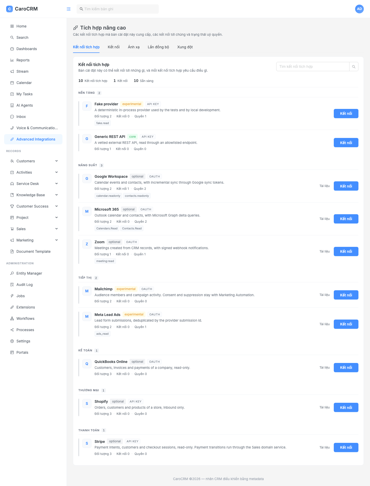
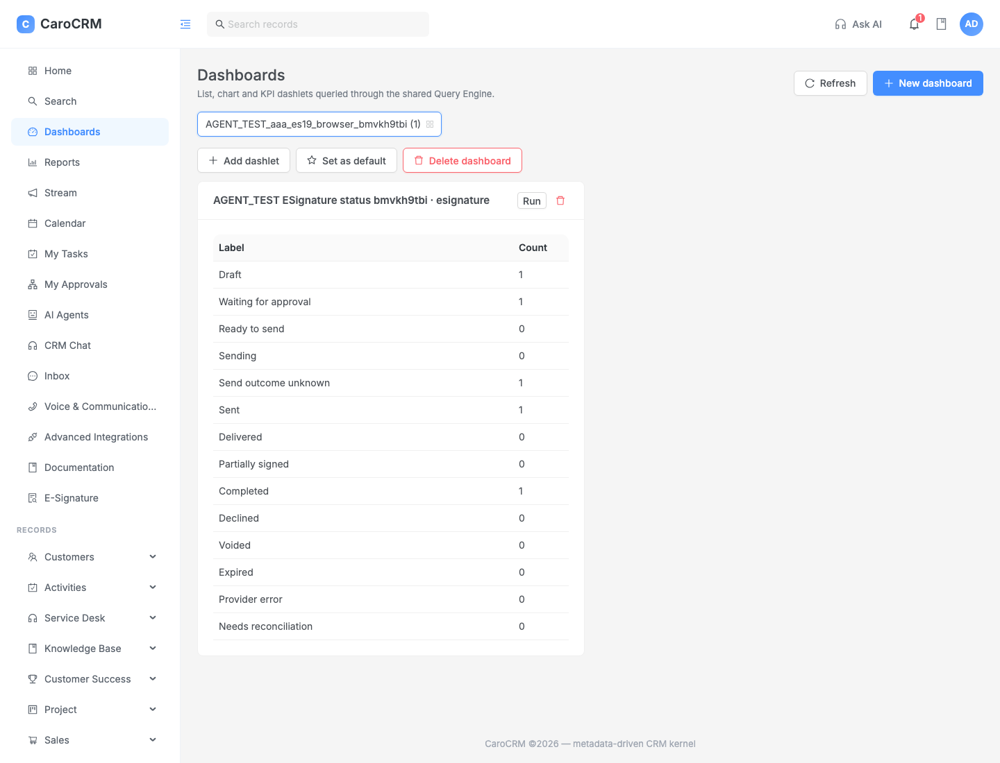
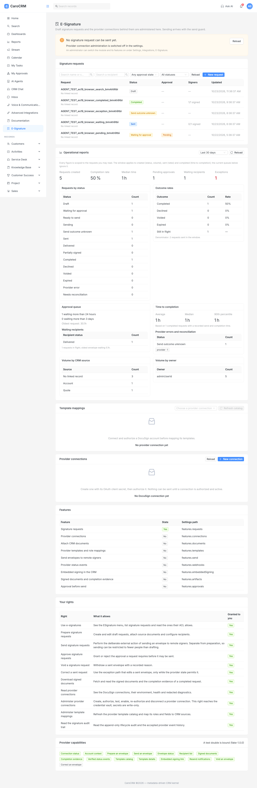

# CaroCRM







Metadata-driven CRM platform: TypeScript + NestJS + Fastify + Kysely/PostgreSQL, a clean-room
reimplementation of EspoCRM concepts (no PHP runtime, no upstream source copied).

**Current state: CRM Kernel Alpha + ten Phase 19 domain modules — Projects, Sales (19-S),
Customer Success (19-CS), Service Desk (19-SD), Marketing Automation (19-MA), Voice & Communications
(19-VC), AI Agents (19-AI), Advanced Integrations (19-INT), CRM Chat (19-CHAT) and E-Signature
(19-ES) — plus Phase 20 (settings, administration and end-user UX) and Phase 21 (the in-app
handbook).**

_Roadmap_ — [PLAN.md](PLAN.md) for the kernel and module roadmap, plus the phase-level plans
[Projects](PLAN_Phase_19_Projects.md) · [Sales](PLAN_Phase_19_Sales.md) ·
[Customer Success](PLAN_Phase_19_Customer_Success.md) · [Service Desk](PLAN_Phase_19_ServiceDesk.md) ·
[Marketing Automation](PLAN_Phase_19_Marketing_Automation.md) ·
[Voice & Communications](PLAN_Phase_19_Voice_Communications.md) ·
[AI Agents](PLAN_Phase_19_AI_Agents.md) · [Advanced Integrations](PLAN_Phase_19_Advanced_Integrations.md) ·
[CRM Chat](PLAN_Phase_19_CRM_Chat.md) · [E-Signature](PLAN_Phase_19_ESignature.md) ·
[Settings & UX](PLAN_Phase_20_Settings_UX.md) · [In-app documentation](PLAN_Phase_21_Documentation.md).

_Kernel_ — metadata engine with DB-backed overrides, generic entity/query/ACL engines, a
metadata-driven React SPA and Entity Manager, stream, calendar, dynamic logic + sandboxed formula
engine, entity lifecycle hooks, transactional-outbox domain-event bus, audit, a BullMQ worker with
progress/logs/cancellation, attachments over a pluggable storage port (streaming, S3/MinIO,
malware-scan hook, chunked upload), outbound email over a transport port (SMTP/relay, per-account
encrypted credentials, delivery ledger, `system.sendEmail`), and the kernel-owned **document
module** (`packages/document`): `{{ }}` / `{{{ }}}` / `{{#each }}` templates, block layout to text
and an optional pdfkit adapter, exposed as `DocumentTemplate` records.

_SPA look_ — the web app follows the **Carocrm** Ant Design admin theme: tokens in
`apps/web/src/theme.ts` (ConfigProvider) plus the rules antd cannot express in
`apps/web/src/styles/carocrm.css`, and a derived-field-caption helper (`fieldLabel()` in
`state/metadata.ts`). Every record list has two views: the table and a **generic Kanban board**
(`/<Entity>/board`) whose columns are the values of any enum field, available whenever the entity
has one. Dragging a card issues an ordinary `PATCH /:entity/:id`, so validation, hooks, audit,
optimistic locking and record ACL apply unchanged and the server is the authority.

_Domain modules_ — search, saved filters, CSV import/export and dashboards (Phase 12);
extension SDK plus three sample packages under `modules/` (Phase 14); workflow engine with run
history (Phase 15); BPM approvals with user tasks, timers, gateways and an audit trail (Phase 16);
reports with preview, CSV export and owner-only scheduled delivery (Phase 17); portals with their
own role space and one-hop visibility (Phase 18); i18n catalogs for `en`/`vi` (Phase 7A).

_Phase 19_ —

- **Projects** — Plan/Kanban/Gantt views, members, groups, dependencies and cloning.
- **Sales** — document engine, pricing, inventory, payments, subscriptions and commercial analytics.
- **Customer Success** — lifecycle, health scoring, plans, risks, playbooks and renewals.
- **Service Desk** — case numbering, state machine, assignment/queues/routing, conversation
  timeline, email-to-case and web-to-case, business calendars, SLA clocks, Knowledge Base, portal
  self-service, CSAT and metrics.
- **Marketing Automation** — campaign lifecycle with send-readiness validation, audience segments
  with inclusion/exclusion, preview and sealed snapshots, consent/preferences/suppression and public
  unsubscribe, email templates with render preview and revision tracking, provider binding with
  rate/concurrency limiting and an allowlist-gated test send, `MarketingSend` definitions with dry
  run and named approval, a per-recipient delivery ledger, queue-based delivery with throttling and
  retry, provider webhooks and event normalization, campaign log and statistics, journey graphs
  with enrollment/waits/conditions/actions, public lead-capture forms, cross-module CRM events,
  attribution and funnel analytics, and retention/diagnostics (Phases 19-MA.0–19-MA.19).
- **Voice & Communications** — provider accounts (Twilio, Asterisk ARI, a simulator that only binds
  outside production), call control with an agent context panel, SMS/WhatsApp conversations with an
  inbox, message templates, signed provider webhooks with replay and dead-letter, and per-account
  privacy/retention policy (Phases 19-VC.0–19-VC.17).
- **AI Agents** — versioned agent definitions with publish/pause/resume/archive, provider connections
  (OpenAI-compatible, Anthropic; keys write-only), a run state machine with an event timeline, tool
  calls, retry/cancel/resume, MCP tool exposure and worker-driven execution (Phases 19-AI.0–19-AI.20).
- **Advanced Integrations** — a connector framework with OAuth consent, field mappings with preview,
  bidirectional sync orchestration, signed webhook ingress, dead-letter replay and per-connection
  metrics; shipped connectors include Stripe, Mailchimp, QuickBooks Online, Shopify, Google Workspace,
  Microsoft 365, Meta Lead Ads, Zoom, Kit and a generic REST adapter (Phases 19-INT.0–19-INT.27).
- **CRM Chat** — an assistant over your own CRM data: conversations with SSE turn streams, tool steps
  and usage, citations re-read under the reader's permission, prompt templates, answer ratings and
  bounded cross-module analysis scenarios (v1.1, contract 1.2.0).
- **E-Signature** — provider-neutral signing requests (DocuSign and Dropbox Sign adapters; a simulator
  outside production): provider connections with an encrypted credential vault, draft/preview/prepare
  with an approval policy, a deliberate send with double-submit protection, reconciliation and
  recovery for a lost send answer, provider webhooks with HMAC verification and a durable inbox,
  template mappings, signed-document artifacts, reports and an operations panel (Phases 19-ES.0–19-ES.22).
- **Lead Score** — explainable, versioned lead scoring over the existing `Lead` entity plus a
  transactional, idempotent Lead→Contact/Account/Opportunity conversion. **Phases 19-LS.0–19-LS.2 are
  delivered: the repository audit, the module registration and the schema/metadata foundation** — the
  `LeadScore` descriptor with its 14 capability resources, the `leadScore` settings document, the gate in
  front of all 11 planned operations, the health view at `/api/v1/LeadScore/action/health`, the four
  records (`LeadScoreModel`, `LeadScoreRule`, `LeadScoreEvaluation`, `LeadConversionOperation`), the
  current-score projection and `Converted To` attributes on the core `Lead` with their detail panels, and
  the migration that indexes and constrains them. Nothing scores and nothing converts yet — the module
  ships switched off and every operation refuses with the sub-phase that owes it
  (`LEADSCORE_PHASE_PENDING`) — and a client, administrator included, cannot write a score or fake a
  conversion through the record API. See
  [PLAN_Phase_19_LeadScore.md](PLAN_Phase_19_LeadScore.md),
  [docs/implementation/lead-score-audit.md](docs/implementation/lead-score-audit.md),
  [docs/implementation/lead-score-ls1-completion-report.md](docs/implementation/lead-score-ls1-completion-report.md),
  [docs/implementation/lead-score-ls2-completion-report.md](docs/implementation/lead-score-ls2-completion-report.md)
  and [docs/compatibility/lead-score.md](docs/compatibility/lead-score.md).

_Phase 20_ — settings, administration and end-user UX: a settings-document registry with optimistic
concurrency and audit, the tabbed administration shell with a server-resolved, ACL-filtered main menu
(`GET /api/v1/Navigation`), per-user preferences, the list-view power pack, the command palette, the
first-run setup checklist and the shared record/list states. See
[PLAN_Phase_20_Settings_UX.md](PLAN_Phase_20_Settings_UX.md).

_Phase 21_ — the in-app handbook: a reviewed Markdown corpus in `content/docs/` (`en` plus the `vi`
P0 set), a pure documentation engine in `packages/docs` (documented Markdown subset, search ranking,
a lint that fails a release on a dead link or a missing page), served at `/docs` in the SPA and
`GET /api/v1/Docs/(tree|page|search)`, with a **Docs** tab in the administration area. See
[PLAN_Phase_21_Documentation.md](PLAN_Phase_21_Documentation.md) and
[docs/reference/docs-authoring.md](docs/reference/docs-authoring.md).

_Not built yet_ — real inbound mail collection (`POST /api/v1/Email/action/pollInbound` runs a null
provider until an IMAP/Graph adapter is installed), API-user attachment policies, multi-tenancy.
Several provider integrations are delivered but flagged experimental until exercised against a real
account (the Twilio and Asterisk voice adapters, for one); each module's compatibility note states
which parts that applies to.

Marketing Automation ships all its phases, but **sending still requires operator configuration**: the
live adapter wraps the platform's `MailTransport` and is named by the `marketingAutomation` →
`provider.key` setting (empty by default), so `campaign start`/`resume` refuses with
`PROVIDER_NOT_BOUND` until a deployment binds it and allowlists test recipients. See
[docs/runbooks/marketing-send-operations.md](docs/runbooks/marketing-send-operations.md).

Checklist, deviations and known failures: [docs/reference/alpha-status.md](docs/reference/alpha-status.md).
It documents the kernel Alpha scope, the Projects module and the Phase 20/21 additions; every other
Phase 19 module is covered by its own audit, gap report or release note under
[docs/implementation/](docs/implementation/) and its behavior reference under
[docs/compatibility/](docs/compatibility/).

## Requirements

- Node.js >= 22 (tested on 24) and pnpm >= 9
- PostgreSQL reachable via `DATABASE_URL`
- Redis reachable via `REDIS_URL` (worker/queues only)

## Quick start

```bash
cp .env.example .env          # then set at least JWT_SECRET and DATABASE_URL
docker compose up -d postgres redis
pnpm install
pnpm db:seed                  # applies migrations + idempotent seed to DATABASE_URL
pnpm dev:all                  # API on http://127.0.0.1:3030, SPA on http://127.0.0.1:8080
pnpm --filter @carocrm/worker dev   # outbox poller, BullMQ worker, cron scheduler
```

`pnpm db:seed` never creates or drops a database — it runs every pending SQL migration in
`database/migrations/` (currently up to `070_phase19_esignature_api_key_credential.sql`) and inserts
idempotent configuration (admin user, roles,
teams, entity metadata, default project board, scheduled jobs) into the database you already point
at. Sign in with `admin` / `admin` (override with `SEED_ADMIN_LOGIN` / `SEED_ADMIN_PASSWORD`; an
existing admin password is never overwritten). `pnpm db:seed -- --demo` additionally creates a
`demo` / `demo123` user with no access, for ACL checks.

`.env.example` documents every variable; the ones you are most likely to touch are
`STORAGE_DRIVER`/`S3_*` (attachments), `MAIL_TRANSPORT`/`SMTP_*` (outbound mail, and the transport
Marketing Automation sends through), `ENCRYPTION_KEY` (32-byte hex key: required by every module that
stores a provider credential — email accounts, extension secrets, AI provider connections, voice
provider accounts, the E-Signature credential vault and Advanced Integrations connector secrets),
`EXTENSIONS_DIR`, `REPORT_WORKER_SECRET` (worker-driven jobs:
scheduled report delivery and AI Agent runs, including CRM Chat) and the upload ceilings. Domain modules keep their configuration in settings
(`app_settings`), not in the environment — see `GET /api/v1/MarketingAutomation/action/settings`.

## Commands

| Command                                          | Purpose                                                                           |
| ------------------------------------------------ | --------------------------------------------------------------------------------- |
| `pnpm dev`                                       | API with reload (`http://127.0.0.1:3030`)                                         |
| `pnpm --filter @carocrm/web dev`                 | SPA dev server (`http://127.0.0.1:8080`, proxies `/api`)                          |
| `pnpm dev:all`                                   | API + SPA together                                                                |
| `pnpm --filter @carocrm/worker dev`              | background worker (outbox + jobs + cron)                                          |
| `pnpm db:migrate` / `pnpm db:seed`               | schema migrations and idempotent seed                                             |
| `pnpm demo:projects`                             | projects demo data (`pnpm demo:projects:purge` removes exactly what it created)   |
| `pnpm lint` / `pnpm lint:fix` / `pnpm typecheck` / `pnpm -r build` | quality gates                                      |
| `npx vitest run [path…]`                         | vitest suites (`apps/api/test`, `packages/*/src`) against the configured database |
| `pnpm --filter @carocrm/worker test`             | worker suites (jobs, scheduler, outbox, uploads, mail, workflows, module handlers) |
| `pnpm test:e2e` (`scripts/e2e-smoke.sh`)         | HTTP end-to-end checks; boots its own API on a scratch port                       |
| `npx playwright test`                            | browser tests in `e2e/` (boots its own API + SPA)                                 |
| `bash scripts/worker-smoke.sh`                   | worker checks against the real Postgres + Redis, without the API                  |
| `docker compose up postgres redis`               | local infrastructure                                                              |

Test suites, smoke scripts and Playwright all run against the configured `DATABASE_URL` and tag
what they create with a run marker — see [AGENTS.MD](AGENTS.MD) §3 for the database rules that
govern them.

## Layout

```
apps/api        NestJS + Fastify REST API (/api/v1); one folder per module
                (entity, metadata, acl, auth, attachment, email, document, marketing-automation,
                projects, sales, customer-success, service-desk, portal, workflows, processes,
                voice-communications, ai-agents, advanced-integrations, crm-chat, esignature,
                docs, admin-panel, settings, setup-checklist, preferences, …)
apps/worker     BullMQ worker, outbox poller, cron scheduler, per-module handlers
apps/web        metadata-driven React SPA
packages/       core, metadata, entity-engine, query-engine, acl, files, jobs, extension-sdk,
                workflow, bpm, formula, document, mail, search, reports, docs (the handbook
                engine behind /docs) (+ reserved api-client, test-kit, ui-schema placeholders)
modules/        sample extension packages (field package, integration, CRM domain module)
database/       SQL migrations, migration runner, seed data + entity metadata
i18n/           translation catalogs per locale (`en`, `vi`), loaded by the API at boot
content/docs/   the in-app handbook corpus (per-locale sections, reviewed like code)
e2e/            Playwright browser specs, one per feature area
docs/           module guide, workflows, bpm, extension SDK
  modules/      per-module guides (projects, sales, customer-success, service-desk, document,
                voice-communications, ai-agents, crm-chat, advanced-integrations, esignature)
  marketing-automation/  campaign lifecycle, consent, templates, provider adapters, sends,
                         cross-module integration
  reference/    alpha status, EspoCRM compatibility matrix, handbook authoring rules
  compatibility/         per-module behaviour reference (service-desk, marketing-automation,
                         voice-communications, ai-agents, advanced-integrations, esignature,
                         settings-ux, documentation)
  implementation/        audits, gap and release reports
  integrations/          cross-module contracts (sales)
  operations/  runbooks/  backup-restore, marketing send operations, esignature admin
                         setup and operations, advanced integrations
```

## API surface (Alpha)

Authentication and identity:

- `POST /api/v1/Authentication`, `/Refresh`, `/Logout`, `GET /api/v1/AppUser/me` (`PATCH` too)
- `GET|POST /api/v1/User`, `GET|PATCH|PUT|DELETE /api/v1/User/:id`, `POST /api/v1/ApiUser`,
  `GET /api/v1/ApiKey/:apiUserId`, `DELETE /api/v1/ApiKey/:keyId`
- `GET /api/v1/Role[/:id]`, `POST /api/v1/Role`, `PATCH|PUT /api/v1/Role/:id`, `GET /api/v1/Team[/:id]`

Metadata and generic records:

- `GET /api/v1/Metadata`, `GET|POST /api/v1/Metadata/:entity`, `DELETE /api/v1/Metadata/:entity/Field/:field`
- `GET|POST /api/v1/:entity`, `GET|PUT|PATCH|DELETE /api/v1/:entity/:id`
- `POST /api/v1/:entity/:id/restore`, `POST /api/v1/:entity/action/massUpdate|massDelete`
- `GET|PUT|DELETE /api/v1/:entity/:id/:relation[/:relatedId]`
- `POST|GET /api/v1/:entity/action/export`, `POST /api/v1/:entity/action/import`,
  `GET /api/v1/:entity/action/exportColumns`
- `GET /api/v1/I18n?locale=` (public catalog + instance locale/timezone settings),
  `POST /api/v1/Formula/validate|evaluate`, `GET /api/v1/Hook`, `GET /api/v1/DomainEvent`

Collaboration and activity:

- `GET /api/v1/Stream`, `GET /api/v1/:entityType/:entityId/stream`,
  `GET|PUT|DELETE /api/v1/:entityType/:entityId/subscription`, `POST|DELETE /api/v1/Note[/:id]`
- `GET /api/v1/Notification`, `POST /api/v1/Notification/Read-all`, `POST /api/v1/Notification/:id/Read`
- `GET /api/v1/Calendar`, `GET /api/v1/AuditLog[/:id]`

Attachments:

- `POST /api/v1/Attachment/upload`, `GET /api/v1/Attachment/:id`, `GET /api/v1/Attachment/:id/file`,
  `GET /api/v1/Attachment/:id/url` (object storage only), `DELETE /api/v1/Attachment/:id`,
  `GET /api/v1/Attachment/action/info`
- `POST /api/v1/AttachmentUpload/init`, `POST /api/v1/AttachmentUpload/:id/part`,
  `GET /api/v1/AttachmentUpload/:id`, `POST /api/v1/AttachmentUpload/:id/complete|abort`

Email:

- drafts are ordinary `POST|GET|PUT|PATCH|DELETE /api/v1/Email` records; delivery is queued
  `GET /api/v1/Email/action/transport`, `POST /api/v1/Email/action/verify`,
  `POST /api/v1/Email/action/pollInbound` (null provider today), `POST /api/v1/Email/:id/action/send`,
  `GET /api/v1/Email/:id/deliveries`
- `GET|POST /api/v1/EmailAccount`, `GET|PATCH|DELETE /api/v1/EmailAccount/:id`,
  `POST /api/v1/EmailAccount/:id/action/verify`

Documents (kernel module):

- `GET|POST /api/v1/DocumentTemplate`, `PATCH /api/v1/DocumentTemplate/:id`
- `GET /api/v1/document/defaultTemplate?entityType=`, `POST /api/v1/document/action/preview`
  (administrator only) — see [docs/modules/document/](docs/modules/document/README.md)

Search, filters and dashboards:

- `GET /api/v1/Search`, `GET|POST /api/v1/Search/:entity`
- `GET|POST /api/v1/SavedFilter`, `GET|PATCH|DELETE /api/v1/SavedFilter/:id`, `POST /api/v1/SavedFilter/:id/action/run`
- `GET|POST /api/v1/Dashboard`, `GET|PATCH|DELETE /api/v1/Dashboard/:id`, dashlet routes under
  `/api/v1/Dashboard/:id/dashlets[/:dashletId]` including `action/run`

Jobs and scheduling:

- `GET|POST /api/v1/Job`, `GET|POST /api/v1/ScheduledJob`, `POST /api/v1/ScheduledJob/action/preview`,
  `POST /api/v1/ScheduledJob/:id/(enable|disable)`, `POST /api/v1/ScheduledJob/:id/action/runNow`

Reports:

- `GET|POST /api/v1/Report`, `GET|PATCH|DELETE /api/v1/Report/:id`, `POST /api/v1/Report/:id/action/run`,
  `GET /api/v1/Report/:id/action/export`, `POST /api/v1/Report/action/preview`,
  `GET|POST /api/v1/Report/:id/schedule`, `POST /api/v1/Report/:id/schedule/(enable|disable)`,
  `DELETE /api/v1/Report/:id/schedule` (delivery runs in the worker through
  `POST /api/v1/Report/action/deliver-scheduled`)

Workflows and processes:

- `GET|POST /api/v1/Workflow`, `GET|PUT|DELETE /api/v1/Workflow/:id`,
  `POST /api/v1/Workflow/action/validate`, `GET /api/v1/Workflow/action/catalog`,
  `POST /api/v1/Workflow/:id/action/(publish|enable|disable)`, `GET /api/v1/Workflow/:id/runs`,
  `GET /api/v1/WorkflowRun[/:id]`
- `GET|POST /api/v1/Process`, `GET|PUT|DELETE /api/v1/Process/:id`,
  `POST /api/v1/Process/action/validate`, `GET /api/v1/Process/action/catalog`,
  `POST /api/v1/Process/:id/action/(publish|enable|disable)`
- `GET|POST /api/v1/ProcessInstance`, `GET /api/v1/ProcessInstance/:id`, `POST /api/v1/ProcessInstance/:id/action/cancel`,
  `GET /api/v1/ProcessTask[/:id]`, `POST /api/v1/ProcessTask/:id/action/complete`

Portals:

- `GET /api/v1/Portal/me|nav|dashboard`, `POST /api/v1/Portal/dashboard/dashlets/:dashletId/action/run`
- admin-only: `GET|POST /api/v1/Portal`, `GET|PUT|PATCH|DELETE /api/v1/Portal/:id`, portal role and
  navigation/dashboard/dashlet routes under `/api/v1/Portal/:id/…`, and `GET|POST /api/v1/PortalRole`

Projects (records are ordinary entities, these are the domain commands):

- `GET /api/v1/Project/:id/action/(capabilities|plan|board|gantt|stages|members)`
- `POST /api/v1/Project/:id/action/(members|memberUpdate|memberRemove|memberBulk|groupCreate|groupUpdate|groupRemove|groupReorder|taskReorder|taskCreate|milestone|settings|clone)`
- `POST /api/v1/ProjectTask/action/bulk`,
  `POST /api/v1/ProjectTask/:id/action/(update|move|transition|dependencyUpdate|dependencyRemove|collaboratorAdd|collaboratorRemove)`,
  `GET|POST /api/v1/ProjectTask/:id/action/dependencies`, `GET /api/v1/ProjectTask/:id/action/collaborators`

Domain modules (Sales, Customer Success, Service Desk) — records are ordinary entities, these are
the domain commands:

- Sales: `/api/v1/Sales/action/*` (documents, pricing, inventory, payments, subscriptions, reports,
  dashlets, job monitoring) plus `/api/v1/:entity` records (`Product`, `Quote`, `Invoice`, …); see
  [docs/modules/sales/](docs/modules/sales/README.md)
- Customer Success: `/api/v1/CustomerSuccess/action/*` plus `CustomerSuccessProfile` and related records;
  see [docs/modules/customer-success/](docs/modules/customer-success/README.md)
- Service Desk: `/api/v1/ServiceDesk/action/*` plus the `Case` entity and configuration records;
  see [docs/modules/service-desk/](docs/modules/service-desk/README.md)

Marketing Automation (`/api/v1/MarketingAutomation`, see
[docs/marketing-automation/](docs/marketing-automation/integration.md)):

- module: `action/health`, `GET|POST action/settings`, `action/nav`, `POST action/globalSendPause`,
  `GET action/diagnostics`
- campaigns: `POST action/campaign/:id/(validate|transition|schedule|unschedule|start|pause|resume|complete|cancel|archive|duplicateAsDraft|previewContent|contentRevision)`, `GET action/campaign/:id/(capabilities|history|log|stats|contentRevisions)`
- audience: `GET|POST action/segment/:id/members`, `POST action/segment/:id/(members/remove|refresh)`,
  `GET action/campaign/:id/audiencePreview`, `POST action/campaign/:id/audienceSnapshot`,
  `GET action/snapshot/:id/entries`
- sends: `GET|POST action/campaign/:id/sends`, `GET action/send/:id(/history|/recipients)`,
  `POST action/send/:id/(dryRun|validate|approve|revokeApproval|transition|schedule|queue|pause|resume|cancel|complete)`
- delivery: `POST action/delivery/run-scheduled-batch` (driven by the worker job
  `marketing.deliveryBatch`), `POST action/campaign/:id/sendTest` (allowlist-gated)
- consent & suppression: `POST action/consent`, `GET action/consent/:id(/history)`, `POST action/suppression`,
  `GET action/suppression`, `POST action/suppression/:id/revoke`, `POST action/publicLink`
- journeys: `POST action/journey/:id/(validate|publish|enroll|trigger)`, `POST action/journey/run-batch`
  (worker job `marketing.journeyRunBatch`), `POST action/enrollment/:id/(suspend|resume|exit)`
- analytics: `GET action/campaign/:id/(attribution|funnel)`, `POST action/attribution`,
  `POST action/retention/dryRun`
- cross-module: `POST action/crossModuleEvent`, `POST action/portal/preferences`
- public, token-authenticated rather than session-authenticated:
  `GET public/preferences/:token`, `GET|POST public/unsubscribe/:token`, `POST public/confirm/:token`,
  `GET public/click`, `GET public/open`, `POST public/form/submit`
- provider webhooks: `POST webhook/:providerKey` and `POST webhooks/:providerKey`

Voice & Communications (`/api/v1/VoiceCommunications`):

- module: `action/(health|settings|nav|providers|webhook-events)`, per-account
  `action/accounts[/:key]` with `enabled`, `health` and `endpoints`, event replay via
  `action/webhook-events/:id/replay`
- calls and messaging: `action/calls/(initiate|incoming|:id/(control|context|note|link))`,
  `action/messages/send`, `action/conversations[/:id]` with `timeline`, `history`, `read`, `status`
  and `assign`, the shared `action/inbox`, per-account `action/templates/...`
- signed provider webhooks: `POST /api/v1/integrations/voice-communications/:providerKey/:accountKey/:kind`

AI Agents (`/api/v1/AIAgents`):

- providers and settings: `GET|POST action/settings`, `action/providers[/:key]` (CRUD + `check`),
  `action/tools`, `action/templates`
- agents: `GET|POST action/agents[/:id]` plus `versions`, `validate`, `publish`, `pause`, `resume`,
  `archive`, `restore`
- runs: `GET|POST action/runs[/:id]` plus `events`, `toolCalls`, `retry`, `cancel`, `input`,
  `resume`, `execute`; triggers via `action/triggers/run`, MCP via `action/mcp/(tools|call)`,
  worker entrypoint `action/worker/runs/:id/execute`

Advanced Integrations (`/api/v1/AdvancedIntegrations`):

- module: `action/(health|capabilities|nav|settings|providers[/:providerKey])`
- connections: `GET|POST action/connections[/:id]` plus `credentials`, `pause`, `resume`, `revoke`,
  `authorize`, `reconnect`, `links`, `runs`; mappings `action/mappings[/:id]` with `activate`,
  `retire`, `preview`, `sync`; run inspection `action/runs[/:id]` and `cancel`
- OAuth consent callback `GET /api/v1/integrations/advanced-integrations/oauth/callback` and signed
  webhooks `POST /api/v1/integrations/advanced-integrations/:providerKey/:webhookKey/:kind`

CRM Chat (`/api/v1/CRMChat`):

- module: `action/(capabilities|health|settings)`, conversations `action/conversations[/:id]`
  (list, rename, delete, messages), help search `action/help/search`
- turns: `POST action/turns`, `GET action/turns/:turnId`, `POST action/turns/:turnId/cancel`,
  SSE `GET action/turns/:turnId/events` (resumable with `Last-Event-ID`), `usage` and per-turn
  `feedback`; grounded queries `action/query/execute`, citation re-auth `action/citations/reauthorize`
- assistant actions and templates: `action/actions/:approvalId/(confirm|reject)`, `action/prompts[/:id]`
  (CRUD), cross-module `action/cross-module/(scenarios|analyze)`

E-Signature (`/api/v1/ESignature`, see [docs/modules/esignature/](docs/modules/esignature/README.md)):

- module: `action/(health|capabilities|nav|provider-catalog|settings|gate/check|gate/operations|record-entry|reports|operations)`
- connections: `GET|POST connections[/:id]` plus `secret`, `authorize`, `re-authorize`, `test`,
  `enable`, `disable`, `disconnect`
- requests: `GET|POST requests[/:id]`, `preview`, `prepare`, `request-approval`, `approve`, `reject`,
  `envelope` (+ `abandon`), `send`, `send/recover`, `reconcile`, `events`, `embedded-view`,
  `artifacts/retrieve`, `resend-notification`, `void`, `correct`, recipients and documents sub-routes
- templates: `templates/catalog/(refresh|:connectionId/:templateId)`, `templates/mappings[/:id]` (+ `active`)
- provider callbacks `POST /api/v1/integrations/esignature/:publicId`, DocuSign consent
  `GET /api/v1/ESignature/oauth/callback`

Settings, administration and the handbook (Phases 20–21):

- `GET|POST /api/v1/Settings` (+ `logo`), hosted module settings documents under
  `/api/v1/Settings/documents[/:name]` (GET, POST, `reset`)
- `GET /api/v1/AdminPanel` (the caller's resolved tab catalog), `GET /api/v1/Navigation`
  (ACL-filtered menu tree), `GET /api/v1/SetupChecklist`, per-user `GET|PUT /api/v1/Preferences[/:name]`
- `GET /api/v1/Docs/(tree|page/:section/:slug|search)` — the in-app handbook; admin-only internals
  under `/api/v1/AdminInternal`

Extensions and operations:

- `GET /api/v1/Extension`, `GET /api/v1/Extension/frontend` (any signed-in user),
  `GET /api/v1/Extension/:id`, `POST /api/v1/Extension/action/install`,
  `POST /api/v1/Extension/:id/action/(uninstall|enable|disable)` (admin) — see
  [docs/extension-sdk.md](docs/extension-sdk.md)
- `GET /api/v1/OpenApi`, `GET /health/live`, `GET /health/ready`

Auth: `Authorization: Bearer <jwt>`, `Authorization: ApiKey <keyId>:<secret>`, or the
`CRM-SESSION` cookie (unsafe methods then require `x-csrf-token` matching the `CRM-CSRF` cookie).
Every module route is authenticated and ACL-checked server-side; see
[docs/module-guide.md](docs/module-guide.md) for the runtime rules and
[docs/runbooks/](docs/runbooks/marketing-send-operations.md) for the operational runbooks.

## Documentation

| Document                                                                         | Contents                                                                                          |
| -------------------------------------------------------------------------------- | ------------------------------------------------------------------------------------------------- |
| [docs/module-guide.md](docs/module-guide.md)                                     | read before writing code: runtime rules (explicit `@Inject()` tokens under `tsx`, ESM, strict TS) |
| [docs/workflows.md](docs/workflows.md)                                           | workflow engine, authoring, execution, run history                                                |
| [docs/bpm.md](docs/bpm.md)                                                       | BPM processes, user tasks, gateways, timers, audit trail                                          |
| [docs/extension-sdk.md](docs/extension-sdk.md)                                   | manifest, contributed metadata/providers/jobs/migrations, SPA entries                             |
| [docs/modules/document/](docs/modules/document/README.md)                       | kernel document module: templates, layout, PDF adapter                                             |
| [docs/modules/projects/](docs/modules/projects/README.md)                        | Projects: data model, permissions, API, compatibility                                             |
| [docs/modules/sales/](docs/modules/sales/README.md)                             | Sales: document engine, pricing, inventory, payments, subscriptions                                |
| [docs/modules/customer-success/](docs/modules/customer-success/README.md)        | Customer Success: lifecycle, health scoring, plans, risks, playbooks, renewals                      |
| [docs/modules/service-desk/](docs/modules/service-desk/README.md)                | Service Desk: cases, state machine, assignment, conversation, SLA                                 |
| [docs/marketing-automation/](docs/marketing-automation/campaign-lifecycle.md)     | MA: campaign lifecycle, consent/suppression, templates, provider adapters, send definitions, journey runtime, metrics, security and privacy, cross-module integration |
| [docs/modules/voice-communications/](docs/modules/voice-communications/architecture.md) | Voice: providers, call flow, webhooks, privacy and retention, operations                         |
| [docs/modules/ai-agents/](docs/modules/ai-agents/architecture.md)                 | AI Agents: architecture, agent schema, run state machine, providers, memory, threat model        |
| [docs/modules/crm-chat/](docs/modules/crm-chat/RELEASE_NOTES.md)                  | CRM Chat: release notes (v1.1) and the repository audit behind its AIAgents reuse                |
| [docs/modules/advanced-integrations/](docs/modules/advanced-integrations/feature-contract.md) | Advanced Integrations: feature contract and ADRs for the connector framework          |
| [docs/modules/esignature/](docs/modules/esignature/README.md)                    | E-Signature: provider-neutral request model, connection gate, lifecycle, operations              |
| [docs/runbooks/marketing-send-operations.md](docs/runbooks/marketing-send-operations.md) | operating MA sending: provider binding, limits, test send, error kinds                    |
| [docs/runbooks/marketing-provider-incidents.md](docs/runbooks/marketing-provider-incidents.md) | MA provider incidents: credentials, webhooks, bounce spikes, stalled queues, safe resume |
| [docs/runbooks/esignature-admin-setup.md](docs/runbooks/esignature-admin-setup.md) | E-Signature provider setup: DocuSign consent, Dropbox Sign key, Connect callbacks               |
| [docs/runbooks/esignature-operations.md](docs/runbooks/esignature-operations.md)  | E-Signature operations: recovery queues, reconciliation, reminders, artifact retention            |
| [docs/runbooks/advanced-integrations.md](docs/runbooks/advanced-integrations.md) | Advanced Integrations operations                                                                  |
| [docs/implementation/](docs/implementation/service-desk-release.md)               | per-module audits, gap reports and release notes                                                  |
| [docs/reference/alpha-status.md](docs/reference/alpha-status.md)                 | kernel Alpha + Projects checklist, deviations, verification actually run, web theme, Kanban board |
| [docs/reference/compatibility-matrix.md](docs/reference/compatibility-matrix.md) | behaviour compared against the EspoCRM 9.3.x baseline                                             |
| [docs/reference/docs-authoring.md](docs/reference/docs-authoring.md)             | authoring the in-app handbook: page format, the Markdown subset, what the lint refuses            |
| [content/docs/](content/docs/en/_index.md)                                       | the handbook corpus itself (English plus the Vietnamese P0 set), rendered at `/docs`              |
| [docs/operations/backup-restore.md](docs/operations/backup-restore.md)           | what to back up and how to restore it                                                             |

Read [AGENTS.MD](AGENTS.MD) first. It fixes the rules this repository is developed under:
smallest coherent change, no unrelated refactors, migrations reviewed before they are applied, and
tests that run against the configured database and only touch records they created themselves.

## Licensing

EspoCRM upstream is AGPL-3.0-or-later. This repository is a clean-room reimplementation
(PLAN §2): behavior and public API contracts were used as reference, no upstream source,
assets or translations were copied. A formal compliance review is required before distribution.